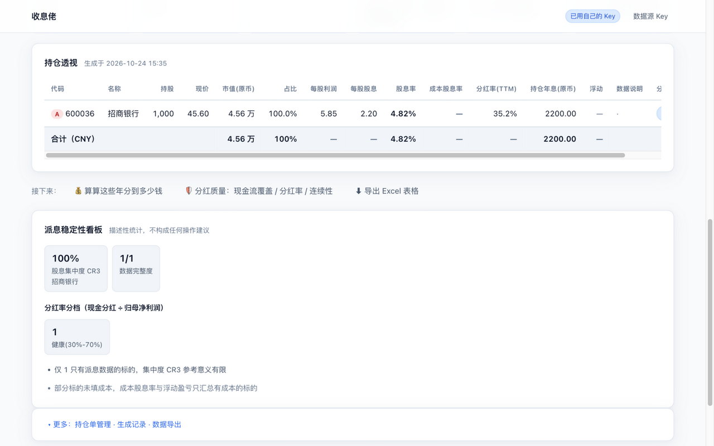
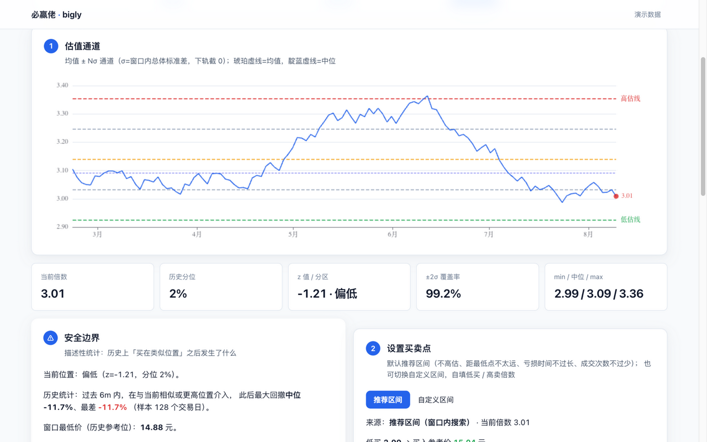

# big-winner（收息佬 · 波段 · 选股）

[](LICENSE)
[](pyproject.toml)
[](https://github.com/open-winmale/big-winner/actions/workflows/ci.yml)

> A 股 / 港股持仓收息、分红日历与记账（**收息佬**）· 估值买卖点区间参考（**波段**）·
> 条件选股（**选股**）。
> **v1.6.0** · [GitHub](https://github.com/open-winmale/big-winner) ·
> [在线体验（只读演示）](https://open-winmale.github.io/big-winner/) · 数据来自
> [wmshare](https://github.com/open-winmale/wmshare)，只做事实与统计聚合；
> 工具代码 MIT；数据来自 wmshare（BSD-3-Clause 开源；云端数据服务需开放平台凭证/额度）。

| 收息佬 · 持仓透视与分红日历 | 波段 · 估值买卖点区间参考 |
|---|---|
|  |  |

*图为收息佬与波段页面截图。一条命令启动后，浏览器打开
`http://127.0.0.1:8787/` 即可在总览页直接进入三个工具体验。

## 目录

[许可与合规](#许可与合规请先读) · [在线体验](#在线体验只读演示数据截止快照日) ·
[快速开始](#快速开始开箱即演示换-key-变实时) ·
[工具一览](#工具一览) · [波段 · 区间与安全边界](#波段--区间与安全边界说明) ·
[选股 · 策略与口径](#选股--策略与口径) ·
[收息佬 · 方法论](#收息佬--方法论) · [设计原则](#设计原则) · [项目结构](#项目结构) ·
[测试](#测试) · [免责声明](#免责声明)

## 许可与合规（请先读）

| | 许可 | 商业使用 |
|---|---|---|
| **本项目代码** | **MIT** | ✅ 允许 |
| **wmshare（数据依赖）** | [BSD-3-Clause](https://opensource.org/licenses/BSD-3-Clause) | ✅ 允许（云端数据服务需开放平台凭证/额度） |

本项目是 source-available 的 wmshare 的**下游工具**。工具代码本身 MIT 可自由使用与改造，
wmshare 本身已放开商用（BSD-3-Clause）；但取数走云端数据服务，仍需
开放平台账号与额度，服务条款以开放平台为准（`Fetcher` 是可替换接口，可换自有数据源）。

**本工具不提供、也永远不会提供任何买卖时点、目标价或仓位建议。**
输出全部为描述性统计，不代表投资建议；数据最终以上市公司公告为准。

## 在线体验（只读演示，数据截止快照日）

打开 **<https://open-winmale.github.io/big-winner/>** 即可浏览：里面是真实数据的
历史快照（页顶横幅**明示数据截止日期**，示例持仓为贵州茅台 600519）——收息透视 /
质量体检 / 记账 / 分红日历 / 波段通道与回放 / 全市场策略选股的预烘结果都能看，
但**不能换持仓、不能取实时**。

任何超出快照的操作都会弹出「本地运行」指引：三行命令启动本地完整版（见下方
快速开始），页面内填入自己的 AppID 即变实时全市场。

## 快速开始（开箱即演示，换 Key 变实时）

**环境要求**：Python ≥ 3.10（本项目零第三方依赖，无需 pip install 本体）；
只有网页版前端开发才需要 Node ≥ 18.18 + npm（见「网页版前端」一节）。

```bash
# 启动（零依赖：无需 wmshare、无需凭证）——一条命令，工具总览 + 全部小工具
cd big-winner
PYTHONPATH=src python -m bigwinner.shouxi    # 门户 → http://127.0.0.1:8787
```

**开箱即演示模式**：没有自己的 Key 时自动进入演示——页面是真实数据的历史快照，
页顶横幅**明示数据截止日期**；示例仅含贵州茅台（600519），其余标的如实显示缺数据
并引导配 Key。演示不联网、不消耗任何额度，先把工具看明白。想强制演示可加 `--demo`。

**换 Key 即变实时**：到 [open.winmale.com](https://open.winmale.com) 申请 AppID
（微信扫码登录，注册即送免费额度），然后：

```bash
# 真实模式需要安装 wmshare（数据依赖）
git clone https://github.com/open-winmale/wmshare.git && pip install -e ./wmshare
```

页面右上角「数据源 Key」→ 粘贴 client_id 与 api-key → **验证通过立即热切换为
实时全市场数据，无需重启**（Key 只写本机 `~/.wmshare/credentials.env`，权限 600，
不会回显）。也可以启动前就配好凭证，服务直接以实时模式启动：

```bash
export WMSHARE_CLIENT_ID=...
export WMSHARE_CLIENT_SECRET=...
# 或写入 ~/.wmshare/credentials.env
PYTHONPATH=src python -m bigwinner.shouxi
```
> 从旧版本升级：凭证配置名已随上游更名——`FINPIPE_*` 环境变量改为 `WMSHARE_*`，`~/.finpipe/credentials.env` 改为 `~/.wmshare/credentials.env`，已配置的用户请迁移。

> `python -m bigwinner.server` 为兼容别名，等价于收息佬入口（即门户）。
> 波段也可独立启动（互不影响）：`PYTHONPATH=src python -m bigwinner.bigly`
> → http://127.0.0.1:8788 ，无凭证同样自动进演示模式。

## 工具一览

| 工具 | 状态 | 说明 |
|---|---|---|
| [波段](/tools/bigly/)（门户直达；独立启动 :8788） | ✅ 可用 | 估值买卖点区间参考 + 拨测回看：PE/PB 均值±Nσ 通道（与平台 web「估值通道」同源）、**区间设置 = 推荐区间（默认，四条约束自动搜点，含成交次数）+ 自定义区间**（自填目标 PE/PB）、安全边界（高位介入回撤统计 + 止损参考）、**区间分布与极值**（估值/股价三区分布、距极值溢出）、多轮进出历史回放与「波段 vs 长持」收益对比；窗口半年~3 年，默认半年，进页自动加载。总览页直达；也可独立启动 :8788 |
| [收息佬](/tools/dividend-xray/) | ✅ 可用 | 攒股收息驾驶舱：分红日历、每票持续性分析、A/HK 持仓透视（总市值/总利润/股息率/成本股息率）+ 派息稳定性看板 |
| [选股](/tools/screener/) | ✅ 可用 | 预置策略 · 一键全市场选股：格雷厄姆（简化）、高股息、破净、派息健康等策略一句话讲清口径，清单数字即入选证据，一键加入观察池跟踪。选股结果 ≠ 推荐（详见[选股 · 策略与口径](#选股--策略与口径)） |
| 收息驾驶舱（透视表顶部） | ✅ 可用 | 自动载入最近持仓 → 未来 7/30/90/365 天除权与到账、税后现金、年息目标进度 |
| 分红记账（透视表内） | ✅ 可用 | 按除权历史算税前/税后股息；A 股按持有时长分档，港股默认 20%，支持单票/年度/统一税率覆盖 |
| 分红质量（透视表内） | ✅ 可用 | 经营现金流/FCF 对股息覆盖 + 分红率 3/5 年 + 连续性/意愿双轴；只评 A 股非金融，金融股/港股显式标注不评分 |
| 分红持续性分析（每票） | ✅ 可用 | 每只股票都有「持续性分析」按钮，弹出可视化：档案（含企业类型）+ 覆盖条 + 分项得分条 + 近 5 年分红柱状图 |
| 高股息池日历（无持仓） | ✅ 可用 | 平台高股息选股池 + 已公告分红事件；不是全市场逐票扫描，可切 A 股/港股 |
| 攒股纪律雷达 | 规划中 | 股息率历史分位 + 估值分位 + 派息可持续性的量化检查表 |
| 预测股息现金流 | 规划中 | 基于预测每股分红估算未来 12 个月现金流 |

## 波段 · 区间与安全边界说明

**估值通道**（与平台 web「估值通道」算法同源，借鉴其公开实现）：在 PE/PB 坐标上画
**均值 ± Nσ** 通道——σ 为窗口内估值序列的**总体标准差（÷N）**，下轨截 0（估值倍数
不为负）；−2σ 为低估线、+2σ 为高估线，另有 ±1σ 内线与均值/中位参考线。当前位置以
z=(current−avg)/σ 描述，分五档，并给出 ±2σ 通道内交易日覆盖率与历史分位。
**窗口上限 3 年**（半年/1y/2y/3y）。数据来自 wmshare `cli.valuation.hist_stats`
（与平台同源的宿主 HIST_STATS）；亏损期 PE 无数据、净资产为负期间不参与统计。

**买卖点换算**：`价格 = 现价 × 目标倍数 / 当前倍数`（线性，隐含口径内 EPS/BPS 恒定）。
最低/最高**两种来源**：① **推荐区间**（默认）——见下节；② **自定义区间**——自填目标
PE/PB 倍数（如 PE 12/25、金融股 PB 0.8/1.0）。通道低估线/高估线不再作为手动来源，
仅当推荐区间搜索全程无完整进出时作为内部回退，并如实标注。

**代码搜索**：输入框支持代码/名称/拼音联想（与收息佬共用 wmshare 离线全市场代码
目录，零网络），选中即自动加载；也可直接输 6 位代码回车。

**推荐区间**（窗口内自动搜点，回答「从哪买、到哪卖比较合理」）：穷举候选买卖倍数
组合（买点网格 ≤ 均值、卖点网格 ∈ [均值, 高估线]），以**窗口内多轮进出回放**评估
（见下「拨测规则」），须满足四条约束——① **不高估**：买点倍数不高于窗口均值；
② **距最低点不要太远**：买入参考价 ≤ 窗口最低收盘价 × 1.15；③ **亏损时间不要
过长**：窗口内「持仓且收盘低于成交买价」的交易日占比 ≤ 35%；④ **成交次数不要
太少**：窗口内完整进出 ≥ 2 次（一年只成交一次的区间对波段没有意义）。在满足约束
的组合中按「多轮回放收益 → 进出次数 → 亏损占比 → 距最低点距离」择优；无组合同时
满足时逐级放宽（30%/50%，进出次数降到 ≥1，最后仅保留「不高估 + 真实触发 + 至少
1 次完整进出」）并如实标注放宽项；全程无完整进出则回退通道轨。窗口 **半年/1/2/3 年**
（上限 3 年），默认半年，进页自动加载并直出推荐区间与回拨结果。四条约束全部是窗口内
可验证的历史事实，搜索结果是历史回放意义上的择优，**不是预测，更不是建议**。

**区间分布与极值**（窗口内逐日统计，描述性）：
- **估值倍数三区分布**：低于低估线 / 通道内（±2σ）/ 高于高估线的天数与占比
  （与覆盖率同口径，轨上一点计入通道内）；
- **股价 × 买卖点三区分布**：收盘价低于当前买点价（历史上「挂单能成交」的日子）、
  买卖点之间、高于卖点价的天数与占比——买卖点切换来源后随回拨刷新；
- **距极值溢出**：窗口最低/最高收盘及其日期，现价较最低价的溢价（溢出多少）、
  较最高价的折价。

**安全边界**（全部为描述性统计，工具不会阻止、也不会建议）：
- 高位警示：z≥+1 或历史分位 >70% 时显著提示「当前处于历史高位区」；
- **高位介入回撤统计**：窗口内位置分位 ≥ 当前分位的全部交易日作为假想买点，
  各自此后最大回撤的中位/最差（「过去 3 年，在相似或更高位置介入，此后最大回撤
  中位 -X%、最差 -Y%」）；
- 止损参考：窗口最低价；未设止损时回拨结果固定显示「无止损最差浮亏」。

**拨测规则**：日 low≤买点触发买入（成交 min(open, 买点)）；持仓日 high≥卖点止盈
（max(open, 卖点)）、low≤止损止损（min(open, 止损)）；同日双触发按保守先止损；
T+1 买入当日不卖；**止盈/止损出场后资金回笼，卖出次日可再次买入**，回放窗口内
全部进出（回拨与推荐区间评估均为多轮口径）；多轮收益按各轮复利（空仓期收益 0，
不含现金利息）；窗口末仍持仓输出浮动收益；另输出**亏损持仓统计**（持仓且收盘
低于成交买价的交易日合计，推荐区间的约束 ③ 即基于此）与**完整进出次数**（约束
④）。简化假设：不含涨跌停与成交量约束；qfq 前复权口径。**对比基准**：长持 =
首日收盘买入持有至窗口末（不含现金收益）。

**免责声明**：波段全部输出为统计描述与历史回放，不构成任何投资建议；买卖点由
你自己设定与负责。免责在页面顶部横幅、页脚与结果区三处显著呈现。

## 选股 · 策略与口径

**预置策略 · 一键全市场**：选一张策略卡，对全市场执行，直接输出带数字的选股
清单——数字就是入选证据；可一键把结果加入平台观察分组，接续收息佬的分红日历
监控与深度体检。

| 策略 | 口径 | 市场 | 阈值出处 |
|---|---|---|---|
| 高股息 ≥3% | TTM 股息率 | A 股 | 与平台高股息池同口径 |
| 高股息 ≥6% | TTM 股息率 | A 股 | 深度高息（警惕价值陷阱，体检先行） |
| 格雷厄姆（简化） | 0<PE(TTM)≤15 ∧ 市净率<1.5 | A 股 | 经典安全边际（数学上蕴含 PE×PB<22.5）；PE 下界排除亏损股（负 PE 是亏损不是便宜）；流动比率/盈利年限等完整条款数据源暂无全市场字段，如实标注 |
| 低估值高息 | 0<PE(TTM)≤15 ∧ 股息率≥3% | A 股 | 价值 × 现金流的交集（PE 下界同上） |
| 破净股 | 0<市净率<1 | A 股 | 资产价值（排除负净资产的 ST 边缘票；注意资产质量，体检先行） |
| 派息率 30%–70% | TTM 派息率区间 | A 股 | 与分红质量方法论同源 |
| 港股高息 ≥6% | TTM 股息率 | 港股 | 港股通红利税默认预扣 20%，6% 起步覆盖税后 |
| 自定义组合 | 股息率 ≥x / PE ≤x / 市净率 ≤x（AND，可留空） | A 股 | 阈值自填 |

执行通道：与平台 web「选股」同源（`wm-screen-index` conditions；实测
`$PE_TTM_LAST`、`$PB_TTM_LAST`、股息率 cn/hk 均可用，2026-10-26），
**每策略 1 次查询**；通道未配置（无 wm.sh）时页面如实降级提示，不静默。
「加入观察池」（把选股结果写进 winmale 关注分组）与收息页的观察分组导入
同样走 `wm.sh` 门面——这是作者本地环境的一部分（skillhub 仓库），外部用户
暂无开箱即用的替代：未配置时按钮会明确报错并提示 `WM_SH` 的配置方法，
其余功能不受影响；持仓档案 / 快照 / 导出等本地功能均不依赖它。
结果按策略口径排序、口径列前置；「—」为取数缺失，不冒充；demo 模式用
确定性罐头数据，零凭证可试。**选股结果 ≠ 推荐**；深度体检接
「收息佬 · 分红质量 / 持续性分析」。wmshare 原生 index 积木暂不可用
（spec 契约变更，roadmap 跟进，作为无 wm.sh 场景的备选降级路径）。

## 收息佬 · 方法论

### 持仓收息透视表 · 数据契约

每个字段都对应真实接口，取不到即留空并显式标注，不做猜测填充：

| 字段 | 来源 | 口径 |
|---|---|---|
| 现价 | `kline.query_bars(sym, 1)` | 原币；港股必须 `_raw=True`（HK volume 已是股，常规模式会触发手/股守护） |
| 股息率 / 派息率 | `bonus.snapshot_yield_ttm` / `snapshot_payout_ttm` | 小数；按市场分组批量取数 |
| 每股股息 | `indicator.metrics` → `$DPS_TTM_LAST_REAL` | 报价币种（港股 HKD） |
| 每股利润 | `indicator.metrics` → `$EPS_NPTS_TTM_LAST` | 财报币种（平台港股统一为 CNY） |
| 股息率 10 年分位 / 连续分红年数 | `$PCT_BONUS_RATE_TTM_10Y_LAST` / `bonus.query_list` 本地倒推 | 小数 / 年（深度模式） |
| 港股汇率 | `$CR_HKD_LAST` | HKD→CNY，仅用于组合合计 |
| 分红事件（日历） | `bonus.query_list`（`_raw=True`，按市场批量） | 状态/分红类型/股权登记日/除权日/到账日/dps |
| 最近持仓 | SQLite `position_sets` | 打开页面自动载入最近一份档案 |
| 高股息池（无持仓） | `wm-screen-index` conditions（`$BONUS_RATE_TTM_LAST >= 0.03`） | 观察池，只列已公告事件 |

**港股取数**：必须用 `market="hk"` 的 client + **5 位裸码**（如 `00700`）——用默认
CN client 传 `hk.00700` 时分红库会拼错 key（"港股只有价格、没有分红/EPS"的根因），
工具内部用 CN/HK 双 client 自动路由。**币种纪律**：逐行金额保留报价币种
（A 股 CNY、港股 HKD），组合合计统一折算 CNY，缺汇率时该票不进合计并显式提示。
**调用量**：价格 1 次/票；快照 2 次/市场；指标标准模式 1 次/票（深度 +1）；5 分钟缓存。

### 分红记账 · 红利税口径

- A 股个人差别化红利税，按**买入日→除权日**持有时长估算：≤1 个月 20%；
  1 个月–1 年 10%；>1 年 0%（现行政策暂免）。
- 港股通/H 股默认 20% 预扣，不套用 A 股分档；本地券商、红筹等口径不同时，
  可按单票 / 年度 / 统一税率覆盖。未填买入日按 20% 保守估算并标「估算」。
- 税源优先级：单票覆盖 > 年度覆盖 > 统一税率 > 自动规则；买入日之前的除权记录不计入。
- 实际税额在卖出时由券商结算，本工具给的是估算值。

### 分红质量 · 方法论（v1.1）

参考海内外成熟分红质量分析框架的公开思路，**不做单一黑箱安全分**，
改为双轴 + 硬旗标，所有权重公开可复现；复用平台已验证阈值（分红率 30–70% 健康、
>100% 危险、OCF/NP≥0.8、资产负债率对比行业）。

- **范围纪律**：只对 **A 股非金融**评分（银行/保险/证券 FCF 不适用；港股存在汇率与
  TTM 重复计算口径问题），其余只展示指标并标注原因；实控人/机构/北向/质押、分红政策
  文本、回购金额等 SDK 无稳定数据，一律不纳入；核心指标缺失的票不评分（`核心数据缺失`），
  绝不静默填 0。
- **口径**：分红率 = 现金分红 ÷ 归母净利润（≠股息率）；覆盖统一用净利润做桥
  （`OCF 覆盖 = (经营现金流TTM ÷ 归母净利TTM) ÷ 分红率`，FCF 同式）；连续分红年数、
  削减（>30%）、特别分红按**完整财年**归集，特别分红不计入经常性口径。
- **支付能力（0–100）**：现金流覆盖 35% + 分红率纪律 25% + 资产负债 20% +
  盈利稳定性 20%；≥80 强、60–79 中、40–59 偏弱、<40 弱。
- **分红意愿（A–D）**：连续性 55% + 分红率趋势 30% + 分红金额/特别分红 15%。
- **硬旗标**：分红率超 100%、分红超 OCF/FCF、高股息陷阱（股息率 ≥6% 且支付能力
  <50）、连续分红 <3 年、近两年削减、净利/OCF 为负、特别分红、核心数据缺失。
- **置信度**：高 / 中 / 低；低置信度不参与组合平均。
- **取数成本**：每票 1 次自定义 eval + 每市场 1 次分红历史批量；30 只约 32 次 HTTP。

### 分红持续性分析 · 每票可视化

每只股票（透视表/日历/高股息池/质量表）都有「持续性分析」按钮，弹出可视化：
档案（含企业类型）→ 支付能力分项得分条（权重公开）→ 覆盖条（OCF/FCF，1.0x 基线）→
近 5 年分红柱状图（分红率 + 每股分红，特别分红另列）→ 旗标与下一次分红事件。
金融股/港股显示档案与指标 + 不评分原因。每票约 4–6 次 HTTP，5 分钟缓存。

### 收息驾驶舱 · 分红日历

- **打开即用**：自动载入最近保存的持仓，「换一份」可切换；未来 7/30/90/365 天的
  登记日/除权日/到账日/方案状态与税后现金；预案单独标注，不计入「今年已收」。
- **预案待定**：董事会/股东大会预案即使无确定日期也单独成组，先用「未来有没有
  分红公司」回答用户；持仓没有未来事件时，自动加载高股息池预览（前 6 条）。
- **无持仓**：走平台高股息选股池（`wm-screen-index`，股息率 ≥ 3%）再批量查已公告
  事件——**不是全市场逐票扫描**；该视图依赖 `wm.sh` 门面，未配置时其余功能不受影响。
- **年息目标**：TTM 年息 / 目标进度，以及按当前成本股息率估算还差多少本金。
- **取数成本**：`bonus.query_list` 按市场批量（一次 HTTP）；5 分钟缓存。

## 设计原则

1. **单位纪律** —— 内部一律基础单位（比率小数、金额元），只在渲染层转百分比。
   杜绝 `0.0396` 被读成 `0.04%` 这类量级错误。
2. **缺失显式化** —— 取数失败或返回空，字段留 `—` 并记入该行「数据说明」，
   汇总展示数据完整度 `n/m`。绝不静默填 0。
3. **组合口径正确** —— 组合股息率按**市值加权**，不是各票算术平均；
   股息率/成本股息率只对有完整配对的标的计算，缺价/缺成本的票不污染分子分母。
4. **币种不混算** —— 逐行保留原币，组合合计统一折 CNY；缺汇率时宁可置空并提示。
5. **税口径透明** —— 税额是估算值，税源（自动/单票/年度/统一/港股默认）逐笔标注，可覆盖。
6. **可测试** —— 取数层 `Fetcher` 可替换，`FakeFetcher` 让全部逻辑离线可测。
7. **合规红线** —— 只描述事实（"CR3 = 61%"），不输出指令（"应分散持仓"）。

## 项目结构

```
src/bigwinner/
  server.py              # 兼容别名 = 收息佬门户入口
  shouxi/                # 收息佬（门户 :8787）
    server.py            #   单端口 HTTP（标准库）；挂载 /tools/bigly/ 与 /api/bigly/*
    tools/               #   dividend_xray / dividend_quality / ledger / calendar /
                         #   screener（纯计算层）
    web/                 #   index（总览）/ dividend_xray / screener / assets / setup.html
  bigly/                 # 波段（独立 :8788）
    server.py            #   HTTP + HANDLERS
    channel.py           #   均值±Nσ 估值通道（与平台 percentileBand 同源）
    levels.py            #   买卖点区间：推荐区间 / 自定义区间
    suggest.py           #   推荐区间搜索（四条约束 + 择优 + 放宽标注）
    backtest.py          #   多轮进出回放
    fetchers.py          #   波段侧取数
    web/bigly.html
  common/                # store（SQLite 持仓档案，落 src/data/fptools.db，gitignore）/
                         # fetchers（CN/HK 双 client）/ symbols（离线代码目录）/
                         # export（CSV）/ watchlist_sync（观察分组/高股息池，需 wm.sh 门面）
docs/                   # 设计草稿（screener UI/UX 等）
tests/                  # 23 个文件 / 195 个离线用例
web/                    # 网页版前端（Vue3 + Vite + TS，见下节）
```

新增收息侧小工具：加 `shouxi/tools/<name>.py` → 在收息佬 `server.py` 的 `TOOLS` 与
`HANDLERS` 各注册一条 → 加一个 `web/<name>.html`（或网页版 `web/src/features/` 下加一个页面）。

## 网页版前端（web/）

三个工具的界面正在迁移为 Vue3 单页应用（sift 同栈：Vite + TypeScript + Pinia +
UnoCSS + ECharts），后端 API 与 17 个计算接口**原样复用**，仍是单端口单进程：
`python -m bigwinner.shouxi` 同时托管 API 与构建好的 SPA。

```bash
cd web
npm install
npm run dev        # http://localhost:5173，/api 与 /export 自动代理到 127.0.0.1:8787
                   # 连别的后端：BIGWINNER_BACKEND=http://127.0.0.1:8795 npm run dev
npm run build      # 产物输出到 src/bigwinner/shouxi/web_dist/（gitignore）
npm test           # vitest 单测；npm run typecheck
```

构建一次后，后端自动切换到网页版：`/` 出 SPA，旧链接 `/tools/dividend-xray/`、
`/setup.html` 302 到对应 hash 路由（`/#/shouxi`、`/#/setup`），`/api/*` 与
`/export/*` 不受影响；删掉 `web_dist/` 即回退旧多页界面。开发时改前端保存即热更新，
无需重启后端；后端契约由 pytest 钉死，前端展示层由 vitest 覆盖。

## 测试

```bash
python -m pytest tests -q     # 离线，不需要凭证（CI 每次 push 自动跑）
cd web && npm test            # 前端单测（CI web job 同跑 typecheck + build）
```

23 个文件、195 个用例，覆盖：收息侧加权口径、缺失不污染汇总、税档与覆盖优先级、
港股双市场路由、HKD/CNY 折算、分红日历事件解析/税后现金/年息目标、最近持仓自动载入、
分红质量评分与硬旗标；选股策略注册表、自定义组合编条件、通道解析与不可用降级、
罐头条件语义与确定性；波段侧估值通道数值对齐、四条约束与放宽标注、多轮回放、
无解回退、单端口门户。

## 免责声明

本工具集仅做持仓数据的统计聚合，不构成任何投资建议；数据来自 wmshare，
最终以上市公司公告为准；历史分红不代表未来。投资有风险，决策需独立判断。
